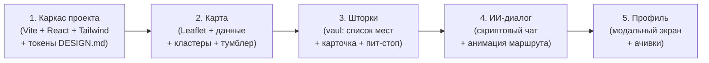

# Решения по проекту «Падарожнiк» — Итоги интервью

## Стек и зависимости

| Решение | Выбор |
|---------|-------|
| Фреймворк | React 19 + TypeScript (strict) + Vite |
| CSS | Tailwind CSS **v3** + CSS-переменные из `DESIGN.md` |
| Карта | **Leaflet** (open-source, без API-ключа) |
| Тайлы карты | **CartoDB Positron** (светло-серые, минималистичные) |
| Кластеризация | `leaflet.markercluster` с кастомными стилями |
| Шторки | **vaul** (Drawer от Emil Kowalski) с 3 snap-points |
| Стейт-менеджмент | **Zustand** (один стор) |
| Иконки | **lucide-react** |
| Шрифты | `Unbounded` (display) + `Onest` (text) — из DESIGN.md |

## Данные

| Решение | Выбор |
|---------|-------|
| Источник данных | **Реальные файлы** (АЗС `data/belorusneft_stations.json` + POI `data/belarus_sights.json`) |
| Парсер данных | `scripts/parse-geo-data.cjs` — валидирует координаты, приводит URL к HTTPS, генерирует нормализованные данные |
| Спарсенные файлы | `data/sights_parsed.json` (6 993 POI, 3 032 с фото), `data/stations_parsed.json` (732 АЗС/ЭЗС) |
| Мета-данные и BBox | `data/geo_meta.json`: BBox `[51.200848, 23.235991] .. [56.171026, 32.624709]`, центр карты `[53.685937, 27.93035]` |

## ИИ-ассистент

| Решение | Выбор |
|---------|-------|
| Тип диалога | **Фиксированный скриптовый** (5–7 шагов) |
| Ввод пользователя | **Только чипы быстрых ответов** (нажал → шаг прошёл) |
| Голосовой ввод | **Имитация** (кнопка микрофона вставляет моковый текст) |
| Анимация маршрута | **CSS stroke-dashoffset** — линия плавно «рисуется» при каждом шаге |

### Сценарий диалога (Happy Path)

```
1. Пользователь: «Хочу съездить из Речицы в Минск, включи 5 достопримечательностей по пути»
2. ИИ: уточняет предпочтения (3 чипа: История / Природа / Архитектура)
3. Пользователь: выбирает «Историю и архитектуру»
4. ИИ: строит маршрут с 5 точками (Красный Берег → Бобруйск → Свислочь)
        + предлагает пит-стоп на АЗС
5. Пользователь: «Да, добавь АЗС с кафе в районе Бобруйска»
6. ИИ: финализирует маршрут, обновляет карту
```

## Интерфейс

| Решение | Выбор |
|---------|-------|
| Нижнее меню | 5 иконок без текста: Дом, Заправка, Карточка, Карта, Бургер — **только «Карта» активна**, остальные декоративные |
| Фото в карточках | **Плейсхолдеры** (цветные градиентные прямоугольники с названием) |
| Чекин-фидбэк | Только смена состояния кнопки: «Отметиться» → «Отмечено ✓» |
| Профиль | **Full-screen модальный экран** (слайд снизу): аватар, баллы, 3–5 моковых ачивок |
| Язык | Русский + белорусский только в брендинге («Падарожнiк») |

## Порядок реализации


