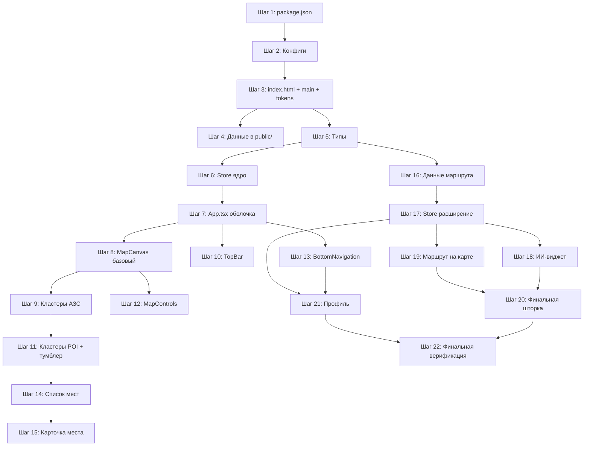

# План реализации MVP «Падарожнiк» — Микро-шаги

> **Правило:** перед выполнением каждого шага агент **обязан активировать** скиллы, указанные в теге `[Скиллы: ...]` этого шага, и следовать их инструкциям на протяжении всего шага.

## Закрытые вопросы

* **Данные:** спарсенные JSON копируются в `public/` для `fetch()` в рантайме.
* **Дубликат:** файл `f:\BelNeft\belorusneft_stations.json` в корне удаляется (канон — `data/belorusneft_stations.json`).

---

## Слой 1 — Инфраструктура и данные

---

### Шаг 1. Scaffold: package.json + установка зависимостей

[Скиллы: —]

**Цель:** создать `package.json` со скриптами и установить все npm-пакеты за один `pnpm install`.

**Место:**
- `[NEW] package.json`

**Границы:** не создавать никаких исходников (`src/`), только манифест пакета.

**DoD:**
```bash
pnpm install          # exit 0, node_modules/ появились
node -e "require('react')"   # exit 0
node -e "require('leaflet')" # exit 0
```

---

### Шаг 2. Конфиги: Vite + TypeScript + Tailwind + PostCSS

[Скиллы: design-taste-frontend]

**Цель:** настроить сборку — алиас `@/`, strict TS, Tailwind v3 с кастомной темой из DESIGN.md (цвета, шрифты, радиусы через CSS-переменные).

**Место:**
- `[NEW] vite.config.ts`
- `[NEW] tsconfig.json` + `tsconfig.app.json` + `tsconfig.node.json`
- `[NEW] tailwind.config.js` + `postcss.config.js`

**Границы:** файлы конфигурации только, без `src/` и `index.html`.

**DoD:**
```bash
npx tsc --version   # TypeScript доступен
```
Конфиги валидны синтаксически (нет ошибок при чтении Vite/TS/Tailwind).

---

### Шаг 3. Точка входа: index.html + main.tsx + tokens.css

[Скиллы: design-taste-frontend]

**Цель:** создать минимальную точку входа SPA. Подключить шрифты Unbounded + Onest через Google Fonts. Прописать все CSS-переменные из DESIGN.md §3.3 + §4.2 в `tokens.css`. Добавить утилитарный класс `.numeric` (`tabular-nums`).

**Место:**
- `[NEW] index.html`
- `[NEW] src/main.tsx`
- `[NEW] src/styles/tokens.css`

**Границы:** `main.tsx` рендерит пустой `<div>Падарожнiк</div>`. Никаких компонентов React.

**DoD:**
```bash
pnpm dev   # dev-сервер стартует, браузер показывает текст «Падарожнiк» шрифтом Unbounded
```

---

### Шаг 4. Данные: копирование в public/ + удаление дубликата

[Скиллы: —]

**Цель:** сделать спарсенные JSON доступными для `fetch()` в рантайме. Удалить дубликат `belorusneft_stations.json` из корня.

**Место:**
- `[COPY] data/sights_parsed.json → public/sights_parsed.json`
- `[COPY] data/stations_parsed.json → public/stations_parsed.json`
- `[DELETE] f:\BelNeft\belorusneft_stations.json`

**Границы:** сырые файлы в `data/` остаются как есть.

**DoD:**
```bash
Test-Path public/sights_parsed.json    # True
Test-Path public/stations_parsed.json  # True
Test-Path belorusneft_stations.json    # False (удалён)
```

---

## Слой 2 — Критическая логика и первый билд

---

### Шаг 5. Типы TypeScript

[Скиллы: —]

**Цель:** определить все интерфейсы данных: `SightPoint`, `StationPoint`, `RouteStop`, `ChatMessage`, `Achievement`, `SheetState`. Структура полей 1:1 с `sights_parsed.json` и `stations_parsed.json`.

**Место:**
- `[NEW] src/types/index.ts`

**Границы:** только типы, без логики и компонентов.

**DoD:**
```bash
pnpm build   # tsc -b проходит без ошибок (пустое приложение с типами)
```

---

### Шаг 6. Zustand Store — ядро (режим + данные + шторка)

[Скиллы: —]

**Цель:** создать единый стор с минимальными срезами: `isTourismMode`, `toggleTourismMode()`, `sights[]`, `stations[]`, `loadData()` (fetch JSON из public/), `sheetState`, `selectedObject`, `setSheetState()`, `setSelectedObject()`.

**Место:**
- `[NEW] src/store/useAppStore.ts`

**Границы:** срезы диалога ИИ, маршрута, чекинов и профиля — **не добавлять**, оставить на шаг 17.

**DoD:**
```bash
pnpm build   # exit 0, нет неиспользуемых переменных
```

---

### Шаг 7. App.tsx — оболочка SPA + первый рабочий билд

[Скиллы: design-taste-frontend, minimalist-ui]

**Цель:** корневой компонент: фиксированный контейнер `max-width: 430px; height: 100dvh; overflow: hidden; margin: 0 auto;` с фоном `--bg-canvas`. Вызывает `loadData()` при монтировании. Отображает заглушку «Карта загружается...» пока данные не пришли.

**Место:**
- `[MODIFY] src/main.tsx` — рендерит `<App />`
- `[NEW] src/App.tsx`

**Границы:** дочерних компонентов (карта, шторки, меню) пока нет — только контейнер.

**DoD:**
```bash
pnpm build   # exit 0 — первый чистый production-билд
```
В браузере: белая колонка 430px по центру с текстом-заглушкой.

---

## Слой 3 — Интерфейс: карта

[Скиллы фазы: design-taste-frontend, high-end-visual-design]

---

### Шаг 8. MapCanvas — инициализация Leaflet + тайлы

[Скиллы: design-taste-frontend]

**Цель:** пустая интерактивная карта Leaflet с CartoDB Positron, центрированная на Беларуси `[53.685937, 27.93035]` zoom 7. Без zoomControl и attribution.

**Место:**
- `[NEW] src/components/map/MapCanvas.tsx`
- `[MODIFY] src/App.tsx` — вставить `<MapCanvas />`

**Границы:** никаких маркеров, кластеров и слоёв — только тайлы.

**DoD:**
```bash
pnpm build   # exit 0
```
В браузере: карта Беларуси на светло-сером фоне, pan/zoom работают.

---

### Шаг 9. Кластеры АЗС + стили кластеров

[Скиллы: design-taste-frontend, high-end-visual-design]

**Цель:** добавить `MarkerClusterGroup` для АЗС (графитовые `#262B28` кластеры 48/56px, пороги 10+/20+/50+/100+). Написать CSS для `.station-cluster-badge` и одиночных маркеров `.single-station-pin`.

**Место:**
- `[MODIFY] src/components/map/MapCanvas.tsx` — блок АЗС-кластеров
- `[NEW] src/styles/map.css` — стили кластеров и маркеров

**Границы:** кластеры достопримечательностей — не добавлять. Маршрутный слой — не трогать.

**DoD:**
```bash
pnpm build   # exit 0
```
В браузере: на карте 732 маркера АЗС, сгруппированные в графитовые кластеры. Зум → кластеры распадаются.

---

### Шаг 10. TopBar: поиск + тумблер Туризм

[Скиллы: ui-ux-pro-max, design-taste-frontend, high-end-visual-design]

**Цель:** верхний оверлей (`z-index: 20`): пилюля поиска (52px, glass-blur, read-only) + круглый тумблер 52×52px. Тумблер OFF → `--bg-glass`; ON → `--color-accent` с ring. Клик → `toggleTourismMode()`.

**Место:**
- `[NEW] src/components/map/TopBar.tsx`
- `[MODIFY] src/App.tsx` — вставить `<TopBar />`

**Границы:** тумблер меняет стейт, но кластеры достопримечательностей ещё не подключены.

**DoD:**
```bash
pnpm build   # exit 0
```
В браузере: поиск и тумблер отрисованы поверх карты. Тумблер переключается визуально. Сверка с DESIGN.md §5.1 (размеры, glass-blur, accent).

---

### Шаг 11. Кластеры достопримечательностей + переключение режимом Туризм

[Скиллы: design-taste-frontend, high-end-visual-design]

**Цель:** второй `MarkerClusterGroup` для достопримечательностей (акцентные `--color-accent` кластеры). Слой добавляется/удаляется при изменении `isTourismMode`.

**Место:**
- `[MODIFY] src/components/map/MapCanvas.tsx` — блок sight-кластеров + эффект на `isTourismMode`
- `[MODIFY] src/styles/map.css` — `.sight-cluster-badge`, `.single-sight-pin`

**Границы:** маршрутный слой и ИИ-виджет не трогать.

**DoD:**
```bash
pnpm build   # exit 0
```
Тумблер ON → на карте появляются зелёные кластеры (~6993 точки). OFF → исчезают.

---

### Шаг 12. MapControls: кнопки +/−/Геолокация

[Скиллы: design-taste-frontend, minimalist-ui]

**Цель:** вертикальный стек справа: `+`, `−` (48×48px, glass-blur), разделитель, кнопка геолокации (акцентная иконка Navigation). `+`/`−` → `map.zoomIn()/zoomOut()`. Геолокация → `flyTo(Минск)`.

**Место:**
- `[NEW] src/components/map/MapControls.tsx`
- `[MODIFY] src/App.tsx` — вставить `<MapControls />`

**Границы:** не вмешиваться в MapCanvas и TopBar.

**DoD:**
```bash
pnpm build   # exit 0
```
Кнопки работают: зум меняется, геолокация перемещает к Минску. Сверка с DESIGN.md §5.1 (48×48px, pill, glass).

---

## Слой 4 — Интерфейс: шторки и навигация

[Скиллы фазы: ui-ux-pro-max, shadcn, design-taste-frontend]

---

### Шаг 13. BottomNavigation: 5 иконок

[Скиллы: ui-ux-pro-max, design-taste-frontend, minimalist-ui]

**Цель:** фиксированный бар 64px, `z-index: 40`. 5 иконок без текста: Home, Fuel, CreditCard, Map (активная с подложкой `--radius-tile`), Menu. Только Menu кликабелен (пока просто `console.log`).

**Место:**
- `[NEW] src/components/navigation/BottomNavigation.tsx`
- `[MODIFY] src/App.tsx` — вставить `<BottomNavigation />`

**Границы:** ProfileModal ещё не существует, клик по Menu — заглушка.

**DoD:**
```bash
pnpm build   # exit 0
```
Сверка с реф 1 и DESIGN.md §5.2: меню внизу, 5 иконок, 4-я выделена подложкой `--radius-tile`.

---

### Шаг 14. LocationListSheet + LocationRow

[Скиллы: ui-ux-pro-max, shadcn, design-taste-frontend, minimalist-ui]

**Цель:** шторка `vaul` Drawer со списком мест. Snap-points: collapsed 220px (2 строки), half-expanded 58dvh. Drag Handle 44×5px. Каждая строка 72px: название + адрес/категория + `+50 Б`. В режиме Туризм — достопримечательности, иначе — АЗС. Клик по строке → `setSelectedObject() + setSheetState('card')`.

**Место:**
- `[NEW] src/components/sheets/LocationListSheet.tsx`
- `[NEW] src/components/sheets/LocationRow.tsx`
- `[MODIFY] src/App.tsx` — условный рендер шторки при `sheetState === 'list'`

**Границы:** `PlaceCardSheet` и `RouteFinalSheet` ещё не существуют.

**DoD:**
```bash
pnpm build   # exit 0
```
Тумблер ON → внизу появляется шторка с реальными названиями из данных. Свайп работает. Сверка с DESIGN.md §4.3 (snap points) и §5.3 (строка 72px, двухколоночная структура, `tabular-nums`).

---

### Шаг 15. PlaceCardSheet: карточка места

[Скиллы: ui-ux-pro-max, shadcn, design-taste-frontend, high-end-visual-design]

**Цель:** детальная карточка объекта (82dvh). Фото 220px (реальное из `image_url` или градиентный плейсхолдер). Заголовок (`Title-Lg`) + адрес (`Caption`). Бенто-блок 3 плитки: «Отметиться» (акцент) / «В маршрут» / «О месте». Описание до 3 строк. Для АЗС — чипы удобств.

**Место:**
- `[NEW] src/components/sheets/PlaceCardSheet.tsx`
- `[MODIFY] src/App.tsx` — условный рендер при `sheetState === 'card'`

**Границы:** логика чекина требует расширения стора — добавляем `checkIn()` inline в этом шаге (минимально, прямо в `useAppStore`).

**DoD:**
```bash
pnpm build   # exit 0
```
Клик по строке в списке → карточка с фото/плейсхолдером. Кнопка «Отметиться» → «Отмечено ✓». Сверка с реф 3 и DESIGN.md §5.4 (бенто 3 плитки, радиусы, правило одного акцента — только 1-я плитка зелёная).

---

## Слой 5 — Интерфейс: ИИ-диалог и маршрут

[Скиллы фазы: ui-ux-pro-max, high-end-visual-design]

---

### Шаг 16. Статические данные: маршрут + ачивки

[Скиллы: —]

**Цель:** создать массивы `DEMO_ROUTE_STOPS` (8 точек Речица → Минск с реальными координатами), `ROUTE_POLYLINE_POINTS` (17 точек полилинии) и `INITIAL_ACHIEVEMENTS` (4 ачивки).

**Место:**
- `[NEW] src/data/routeData.ts`
- `[NEW] src/data/achievementsData.ts`

**Границы:** только данные, без UI и логики стора.

**DoD:**
```bash
pnpm build   # exit 0, типы данных совпадают с types/index.ts
```

---

### Шаг 17. Store — расширение: диалог + маршрут + профиль

[Скиллы: —]

**Цель:** добавить в `useAppStore` срезы: `dialogStep`, `chatMessages[]`, `isAiWidgetOpen`, `nextDialogStep()` (логика 4 шагов), `activeRoute[]`, `routeProgressIndex`, `mapTarget`, `isProfileOpen`, `achievements[]`, `userPoints`, `checkedInIds`.

**Место:**
- `[MODIFY] src/store/useAppStore.ts`

**Границы:** UI компоненты ИИ и профиля — не создавать. Только стейт и бизнес-логика.

**DoD:**
```bash
pnpm build   # exit 0, все экспорты типизированы, нет unused
```

---

### Шаг 18. AiWidget + AiBubble

[Скиллы: ui-ux-pro-max, design-taste-frontend, high-end-visual-design]

**Цель:** капсула ввода (54px, pill, read-only инпут + микрофон) + круглая кнопка ИИ (54×54px). Над ними — `AiBubble` с текстом ИИ и чипами ответов. Показывается при `isTourismMode`. Чип → `nextDialogStep(text)`.

**Место:**
- `[NEW] src/components/ai-widget/AiWidget.tsx`
- `[NEW] src/components/ai-widget/AiBubble.tsx`
- `[MODIFY] src/App.tsx` — вставить `<AiWidget />`

**Границы:** маршрут на карте ещё не рисуется (только стейт обновляется).

**DoD:**
```bash
pnpm build   # exit 0
```
Тумблер ON → виджет над меню. 4 нажатия чипов → полный скриптовый диалог проходит. Сверка с реф 4 и DESIGN.md §5.5 (54px капсула, glass-blur, accent на AI-кнопке).

---

### Шаг 19. Маршрут на карте: полилиния + маркеры остановок

[Скиллы: high-end-visual-design]

**Цель:** `L.layerGroup` для маршрута. При изменении `routeProgressIndex` — отрисовка полилинии (акцентный `#009A49`, weight 6) и нумерованных маркеров остановок. CSS-анимация `stroke-dashoffset` для эффекта «рисования». `flyTo` к текущему сегменту.

**Место:**
- `[MODIFY] src/components/map/MapCanvas.tsx` — route layer + эффект на routeProgressIndex + mapTarget
- `[MODIFY] src/styles/map.css` — `.animated-route-line`, `.route-stop-pin`, `.pit-stop-pin`

**Границы:** RouteFinalSheet ещё не создан.

**DoD:**
```bash
pnpm build   # exit 0
```
Прохождение ИИ-диалога → на карте пошагово рисуется маршрут, камера перемещается.

---

### Шаг 20. RouteFinalSheet: финальная шторка маршрута

[Скиллы: ui-ux-pro-max, shadcn, design-taste-frontend, high-end-visual-design]

**Цель:** шторка 82dvh с итогом маршрута: градиентная шапка «Речица → Минск», вертикальный список остановок, бенто-блок: «В навигатор» (акцент) / «Поделиться» / «Сохранить». Кнопка «В навигатор» → тост «Маршрут перенесён ✓». Открывается по `sheetState === 'route-final'` на последнем шаге диалога.

**Место:**
- `[NEW] src/components/sheets/RouteFinalSheet.tsx`
- `[MODIFY] src/App.tsx` — условный рендер

**Границы:** не менять логику диалога в сторе (она уже выставляет `sheetState = 'route-final'` на step 4).

**DoD:**
```bash
pnpm build   # exit 0
```
Полный Happy Path: тумблер → ИИ-диалог (4 чипа) → маршрут на карте → финальная шторка → «В навигатор».

---

## Слой 6 — Доводка: профиль и финальная верификация

[Скиллы фазы: ui-ux-pro-max, high-end-visual-design, minimalist-ui]

---

### Шаг 21. ProfileModal: профиль с ачивками

[Скиллы: ui-ux-pro-max, design-taste-frontend, high-end-visual-design, minimalist-ui]

**Цель:** full-screen модальный экран (`z-index: 50`, slide-up анимация). Аватар 80px, имя «Падарожнiк», баллы (`--color-accent`, `tabular-nums`), 4 карточки ачивок. Кнопка закрытия `X`. Открывается по клику на Menu в BottomNavigation.

**Место:**
- `[NEW] src/components/profile/ProfileModal.tsx`
- `[MODIFY] src/components/navigation/BottomNavigation.tsx` — Menu клик → `setProfileOpen(true)`
- `[MODIFY] src/App.tsx` — условный рендер

**DoD:**
```bash
pnpm build   # exit 0
```
Бургер → профиль с баллами и ачивками. Закрытие → обратно к карте.

---

### Шаг 22. Финальная верификация и чистка

[Скиллы: ui-ux-pro-max, design-taste-frontend, high-end-visual-design, minimalist-ui]

**Цель:** полный прогон сборки, проверка Happy Path от начала до конца, удаление неиспользуемого кода.

**Место:** все файлы проекта.

**DoD:**
```bash
pnpm build     # exit 0, zero warnings
pnpm test      # unit-тесты стора (toggleTourismMode, checkIn, nextDialogStep)
```

**Ручная проверка (чеклист):**
- [ ] Карта загружается, 732 АЗС в графитовых кластерах
- [ ] Тумблер ON → 6993 зелёных кластера + ИИ-виджет + шторка списка
- [ ] Тумблер OFF → кластеры POI исчезают, виджет скрывается
- [ ] Шторка: свайп 220px ↔ 58dvh, клик по строке → карточка 82dvh
- [ ] Карточка: фото/плейсхолдер, «Отметиться» → «Отмечено ✓», баллы растут
- [ ] ИИ-диалог: 4 чипа → маршрут рисуется на карте пошагово
- [ ] Финальная шторка: список остановок + «В навигатор»
- [ ] Профиль: бургер → ачивки + баллы → закрытие
- [ ] Вьюпорт: 430px по центру, скролл только внутри шторок
- [ ] Типографика: Unbounded в заголовках, Onest в тексте, `tabular-nums` на цифрах
- [ ] Акцент `#009A49` только в 3 местах: тумблер/CTA, кластеры/маршрут, ошибки

---

## Матрица распределения скиллов

| Скилл | Шаги |
|-------|------|
| `ui-ux-pro-max` | 10, 13, 14, 15, 18, 20, 21, 22 |
| `design-taste-frontend` | 2, 3, 7, 8, 9, 10, 11, 12, 13, 14, 15, 18, 20, 21, 22 |
| `shadcn` | 14, 15, 20 |
| `minimalist-ui` | 7, 12, 13, 14, 21, 22 |
| `high-end-visual-design` | 9, 10, 11, 15, 18, 19, 20, 21, 22 |

**Логика распределения:**
- **`design-taste-frontend`** — максимальное покрытие: все шаги с визуальным выводом, где важны токены DESIGN.md (цвета, типографика, радиусы).
- **`ui-ux-pro-max`** — сложные UX-паттерны: шторки со snap-points, ИИ-диалог с чипами, профиль, навигация.
- **`high-end-visual-design`** — визуальный полиш: кластеры с тенями и анимациями, glass-blur, route animation, бенто-блоки.
- **`shadcn`** — только шаги с кастомизированными примитивами vaul (шторки 14, 15, 20), где важно перезаписать дефолтные стили.
- **`minimalist-ui`** — чистые лаконичные компоненты без визуального шума: оболочка, контролы, навигация, список, профиль.

---

## Итоговая карта зависимостей


